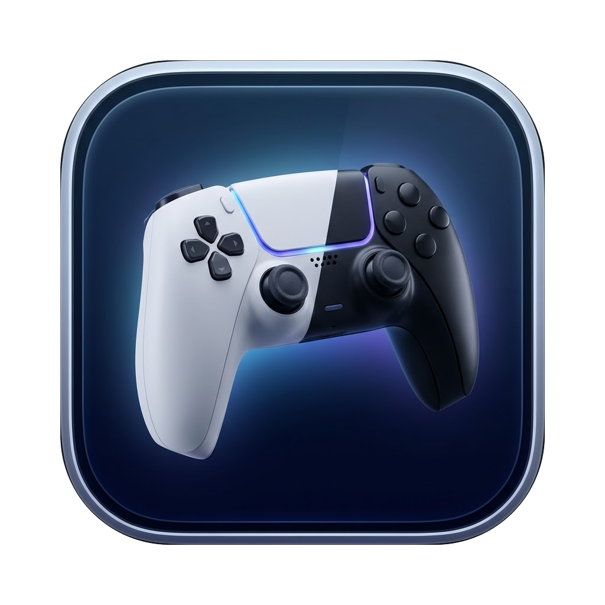
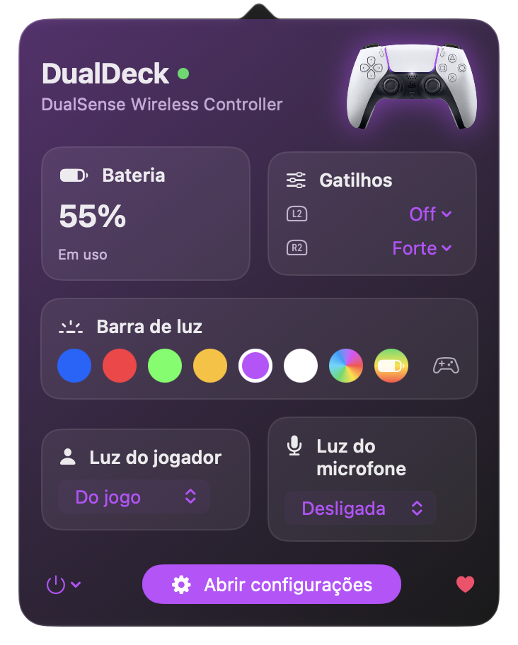
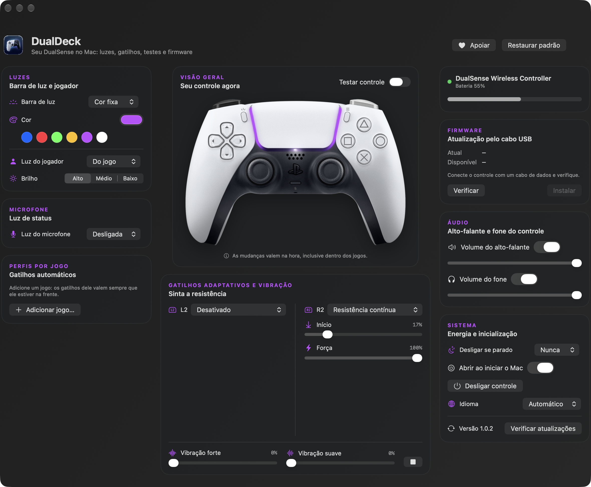

# DualDeck

**English** · [Português](#português)

Your DualSense on the Mac: lights, adaptive triggers, tests and firmware, right from the menu bar.

<p align="center"></p>

<p align="center">
  
  &nbsp;&nbsp;
  
</p>

## Features

- **Light bar**: fixed colour, rainbow, colour by battery, or the game's own; brightness; player LEDs; mic LED.
- **Adaptive triggers** (L2/R2): continuous resistance, weapon trigger or vibration, with adjustable start and strength. Works inside games.
- **Per-game profiles**: each app gets its own triggers, applied while it is in front.
- **Tester**: every pressed button lights up on the controller image; sticks, triggers, touchpad and a drift check.
- **Firmware**: checks and installs Sony's official firmware over USB, through [dsmactools](https://github.com/olliejudge/dsmactools).
- **Power**: battery in the menu bar, low-battery alert, turn the controller off, and auto-off when idle.
- **Several controllers**: each DualSense keeps its own settings.
- **Updates**: the app checks for and installs new versions published in Releases.

## Install

Download the `.dmg` from [Releases](../../releases/latest), drag DualDeck to Applications and open it.

The app is not signed by an Apple developer. On first launch macOS blocks it: go to
**System Settings → Privacy & Security** and click **Open Anyway**.

Requires macOS 15 (Sequoia) or later on an Apple Silicon Mac.

## Build

```sh
./build.sh          # builds, installs to ~/Applications/DualDeck.app and restarts it
./make_dmg.sh       # makes dist/DualDeck-<version>.dmg
```

## Support

DualDeck is free and open source. If it helped you, consider a donation:

- **PayPal**: [donate](https://www.paypal.com/donate/?business=matheusmore%40gmail.com&no_recurring=0&item_name=DualDeck) (matheusmore@gmail.com)
- **Pix** (Brazil): `matheusmore@gmail.com`

The app also has a **Support** button with both options.

## Credits and licences

- DualDeck code: MIT licence (`LICENSE`).
- [dsmactools](https://github.com/olliejudge/dsmactools), bundled for firmware updates: MIT (`Vendor/DSMACTOOLS-LICENSE.txt`).
- Controller image and button masks: exported from Piero Unisono's *PlayStation 5 Controller Mockup*,
  Creative Commons Attribution-NonCommercial (`Resources/CONTROLLER-IMAGE-LICENSE.txt`). For that reason this
  project cannot be sold with these images.

PlayStation, PS5 and DualSense are registered trademarks of Sony Interactive Entertainment. Independent project,
not affiliated with Sony.

---

## Português

Seu DualSense no Mac: luzes, gatilhos adaptativos, testes e firmware, direto da barra de menus.

<p align="center">
  
  &nbsp;&nbsp;
  
</p>

### O que faz

- **Barra de luz**: cor fixa, arco-íris, cor pela bateria ou a do jogo; brilho; luz do jogador; luz do microfone.
- **Gatilhos adaptativos** (L2/R2): resistência contínua, gatilho de arma ou vibração, com início e força ajustáveis. Funciona dentro dos jogos.
- **Perfis por jogo**: gatilhos próprios para cada app, aplicados quando ele está em primeiro plano.
- **Testador**: cada botão apertado acende na imagem do controle; analógicos, gatilhos, touchpad e teste de drift.
- **Firmware**: verifica e instala o firmware oficial da Sony pelo cabo USB, via [dsmactools](https://github.com/olliejudge/dsmactools).
- **Energia**: bateria na barra de menus, aviso de bateria baixa, desligar o controle e desligamento automático quando parado.
- **Vários controles**: cada DualSense com suas próprias configurações.
- **Atualizações**: o app verifica e instala novas versões publicadas nas Releases.

### Instalação

Baixe o `.dmg` em [Releases](../../releases/latest), arraste o DualDeck para Aplicativos e abra.

O app não é assinado por um desenvolvedor Apple. Na primeira abertura o macOS bloqueia: vá em
**Ajustes do Sistema → Privacidade e Segurança** e clique em **Abrir Mesmo Assim**.

Requer macOS 15 (Sequoia) ou posterior e Mac com Apple Silicon.

### Compilar

```sh
./build.sh          # compila, instala em ~/Applications/DualDeck.app e reinicia
./make_dmg.sh       # gera dist/DualDeck-<versão>.dmg
```

### Apoie

O DualDeck é gratuito e open source. Se ele te ajudou, considere uma doação:

- **Pix**: `matheusmore@gmail.com`
- **PayPal**: [doar](https://www.paypal.com/donate/?business=matheusmore%40gmail.com&no_recurring=0&item_name=DualDeck) (matheusmore@gmail.com)

O app também tem um botão **Apoiar** com as duas opções.

### Créditos e licenças

- Código do DualDeck: licença MIT (`LICENSE`).
- [dsmactools](https://github.com/olliejudge/dsmactools), embutido para o firmware: MIT (`Vendor/DSMACTOOLS-LICENSE.txt`).
- Imagem do controle e máscaras dos botões: exportadas do *PlayStation 5 Controller Mockup* de Piero Unisono,
  licença Creative Commons Atribuição-NãoComercial (`Resources/CONTROLLER-IMAGE-LICENSE.txt`). Por isso este
  projeto não pode ser vendido com essas imagens.

PlayStation, PS5 e DualSense são marcas registradas da Sony Interactive Entertainment. Projeto independente,
sem afiliação com a Sony.
